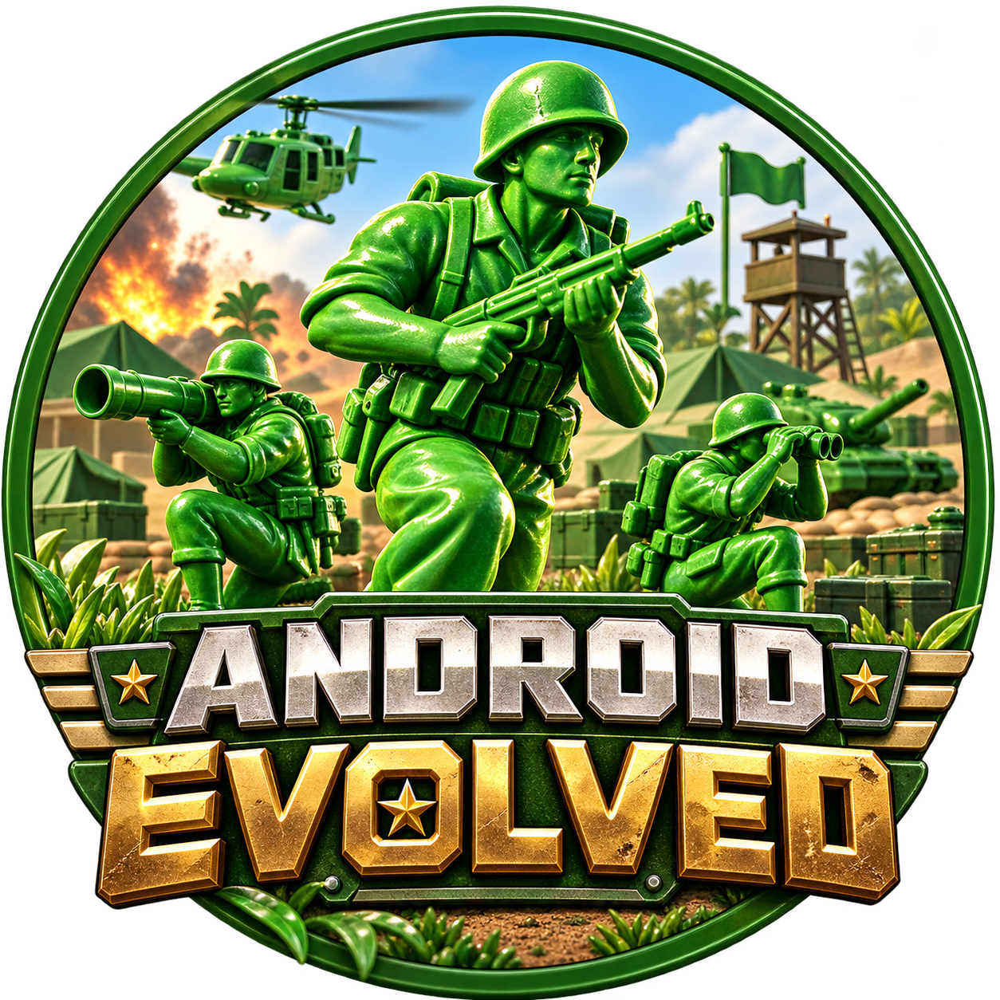

<div align="center">
  
  <h1>Army Men RTS · Android Evolved</h1>
  <p>Port comunitario del juego de PC a Android ARM64, con Vulkan 1.1 como objetivo.</p>
  <p><strong>El arranque recompilado ya enumera el adaptador e inicia DirectDraw sobre Vulkan 1.1. Todavía no hay gameplay.</strong></p>
  
  
  
</div>

## Avance comprobado

| Componente | Estado |
| --- | --- |
| Traducción estática del ejecutable x86 | 29.280 funciones; 98 unidades ARM64 compiladas y enlazadas |
| Cargador PE32 y enlaces de importación | Probado con 4 secciones y 241 importaciones |
| Arranque real del código recompilado | Carga configuraciones, entrada, paquetes y `missions/shells/main`; ejecuta `DrawIndexedPrimitive` |
| Memoria, heap, TLS y sincronización Win32 | Implementación inicial con pruebas en Android |
| Archivos y mapeo de paquetes | Acceso a la copia del usuario; mapeo directo y copy-on-write comprobados |
| Texto, idioma, reloj y versión del PE | CP1252/UTF-8, español y recursos del ejecutable |
| Backend Vulkan 1.1 | Dispositivo real y prueba de framebuffer RGBA con lectura de píxeles comprobados en Adreno 610 |
| Interfaces DirectDraw/Direct3D 7 | Enumeración, referencias COM y consultas iniciales de capacidades; creación de superficies pendiente |
| Audio | Miles Sound System sobre AAudio: efectos WAV y música/voces MP3 (minimp3, dominio público), con volumen general propio del port |
| Controles táctiles | Esquema RTS completo a partir de los atajos del juego; ver [controles](docs/TOUCH_CONTROLS.md) |
| Multijugador LAN | Hilos cooperativos del juego y Winsock sobre sockets Android; partida entre dos teléfonos en la misma WiFi comprobada |
| Drivers gráficos personalizados | Experimental: importación de drivers Vulkan (Turnip, Mali, Xclipse) con [libadrenotools](https://github.com/bylaws/libadrenotools); vuelve al driver del sistema si el importado falla |
| Vídeos Bink y campaña completa | Pendiente |

El APK local ejecuta el inicio del juego mediante el c?digo ARM64 generado. La prueba ADB permanece limitada a 30 segundos. El bot?n **Iniciar (experimental)** usa una ruta continua, con presentaci?n horizontal Android y entrada t?ctil, probada en el S25 Ultra. Al cambiar de aplicación la partida queda en pausa (audio y reloj del juego detenidos) y continúa al volver. **Es un prototipo con la primera misi?n ejecutada**, no una campa?a completa validada: siguen pendientes llamadas del motor y v?deos. El renderizador traduce DirectDraw/Direct3D 7 sobre Vulkan 1.1, distinto del puente Direct3D 9 de [NFSU2 Android Evolved](https://github.com/codepdbh/nfsu2-recompiled).

## Controles t?ctiles

- Toca para seleccionar o dar la orden contextual del juego.
- Arrastra un dedo para seleccionar un grupo.
- Arrastra dos dedos para mover la c?mara; pellizca para hacer zoom.
- Toca con dos dedos o mant?n uno para cancelar.
- Usa el bot?n de men? superior para pausa, detener, cuartel general y pelotones. El HUD original permanece accesible.

El [an?lisis de controles](docs/TOUCH_CONTROLS.md) explica la elecci?n de gestos, sus l?mites y las pruebas.

## Tu copia del juego

Se requiere una copia propia de Army Men RTS para PC. Sus datos se leen desde `Memoria interna/armymenrts/`. El repositorio y el APK no incluyen el ejecutable ni los archivos comerciales.

Con el teléfono conectado y ADB disponible, puedes copiar los datos desde Windows:

```powershell
./scripts/copy_data.ps1 -GameFolder 'C:/ruta/Army Men RTS'
```

El script copia el ejecutable, los paquetes `.x` y `.x-s`, las bibliotecas originales y los directorios de recursos. Conserva las configuraciones ya existentes en Android. La selección de idioma de la copia probada es `spanish`.

## Compilar

Requisitos: JDK 17 o 21, Android SDK 35, NDK 28.2.13676358 y CMake 3.30.5. El objetivo actual es Android 10 o posterior y ARM64.

libadrenotools es un submódulo: clona con `git clone --recursive` o ejecuta `git submodule update --init --recursive`.

```powershell
cd android
./gradlew.bat assembleDebug
```

Este comando construye el diagnóstico mínimo, sin código derivado del juego. El APK queda en `android/app/build/outputs/apk/debug/app-debug.apk` y utiliza `icono/icono.png` a tamaño completo.

Para construir el arranque recompilado, genera primero los C locales y usa:

```powershell
cd android
./gradlew.bat assembleDebug -PamrtsLinkGuest -PamrtsOptimizeGuest
```

## Generar el código ARM64

Se necesitan Python con Capstone y pefile, y el proyecto hermano `pcrecomp` en `../pcrecomp`. Estos comandos suponen la copia del juego en `../Army Men RTS/`:

```powershell
python scripts/run_lift.py catalog '../Army Men RTS/AMRTS.EXE' config/seeds.json work/catalog.json
python scripts/run_lift.py lift '../Army Men RTS/AMRTS.EXE' work/catalog.json src/recomp/gen --split 300
```

El análisis incluye los constructores y terminadores del CRT definidos en `config/seed_ranges.json`. El catálogo, los C generados y los archivos del juego quedan fuera de Git. La versión del ejecutable debe coincidir con las direcciones usadas por la traducción.

## Pruebas en el teléfono

```powershell
./scripts/test_device.ps1
```

El script compila, instala y ejecuta la prueba en segundo plano mediante un receptor restringido a ADB. Comprueba memoria, heap, TLS, sincronización, conversión de texto, archivos, mapeos, recursos de versión y conservación del estado durante callbacks ARM64. El punto alcanzado queda en `work/device-boot-result.txt`. Con varios teléfonos, especifica `-Serial`.

Tambi?n puedes comprobar la entrada y el renderizador en Windows con Visual Studio y un controlador Vulkan:

```powershell
./scripts/test_host.ps1
```

Estas pruebas comparan p?xeles reales de texturas, mezcla alfa, profundidad, borrado por regiones y cambios de viewport, adem?s de comprobar los gestos en JVM. No sustituyen la comprobaci?n del juego en Android.

La prueba de gestos en dispositivo carga el entrenamiento e inyecta selecci?n, zoom, c?mara y cancelaci?n:

```powershell
./scripts/test_touch.ps1 -Serial R5GL70TXWMP
```

## Siguiente trabajo

1. Completar las operaciones DirectDraw/Direct3D 7 que falten y validar la presentaci?n en el S25.
2. Completar hilos y las llamadas de Windows que aparezcan después del arranque gráfico.
3. Adaptar audio, vídeos y controles táctiles para un RTS.
4. Llegar al menú y al gameplay; medir rendimiento y corregir fallos reales.

Proyecto no afiliado al editor original. Distribuye únicamente código propio y arte con derechos de uso; conserva tu copia del juego para aportar los datos.
